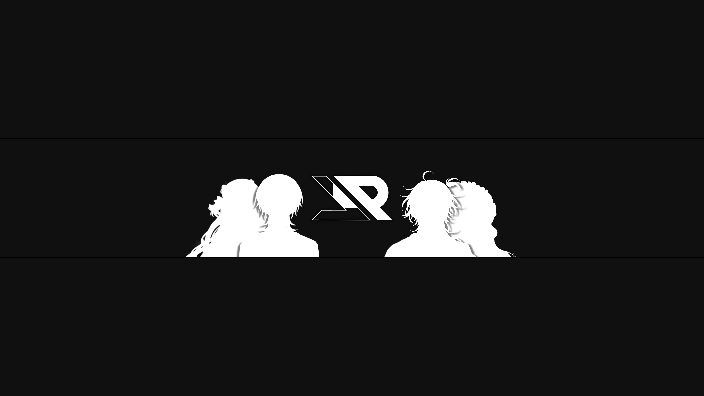

  

  

Hi, I'm <b>tyxmn</b> — 🔥 Trails of Flame. 
I build <b>Figura Cloud & Minecraft solutions</b> at <a href="https://revo.in.th">revo.in.th</a>

  

  

  <a href="https://revo.in.th">Website</a> •
  <a href="https://www.facebook.com/revolution.proj">Facebook</a> •
  <a href="https://www.youtube.com/@Revolution_Project">YouTube</a>

